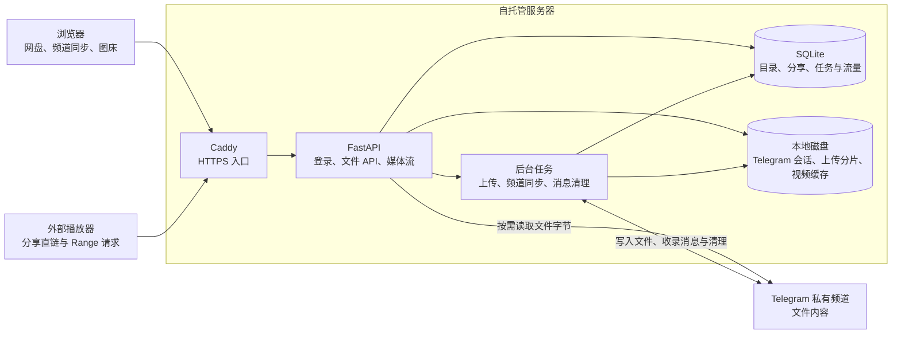
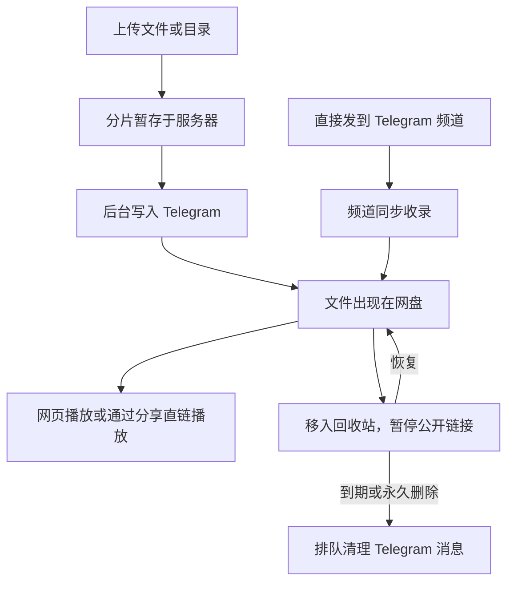

# TG Drive

TG Drive 是一个自托管的个人网盘。文件保存在 Telegram 私有频道，通过网页上传、整理、搜索、分享和播放。服务器保存文件索引、Telegram 会话和上传临时文件，并转发媒体流量。

[部署与备份](DEPLOY.md) · [视频播放与外部直链](docs/video-playback.md) · [架构说明](docs/ARCHITECTURE.md) · [更新记录](CHANGELOG.md)

## 主要功能

| 功能 | 使用方式 |
| --- | --- |
| 文件管理 | 上传文件或整个目录，按名称、类型、日期、大小和扩展名筛选，批量移动或移入回收站。目录和筛选条件可通过网址恢复。 |
| 链接导入 | 每批导入最多两个公网视频直链或 eD2k 视频链接。服务器上传到当前 Telegram 频道，确认清理本批临时文件后才开放下一批。 |
| 频道同步 | 收录 Telegram 频道中的文件。个人会话支持历史扫描，也可以从网页扫码添加账号和切换频道。各频道保留独立的索引、分享和上传任务。 |
| 文件分享 | 创建可过期、可撤销的分享链接。可复制单文件 HTTP 播放直链给外部播放器。持有链接的人无需登录即可访问。 |
| 视频播放 | 浏览器原生播放，支持 HTTP Range、拖动和进度恢复。服务端使用磁盘切片缓存和 MP4 索引预热。播放格式取决于客户端的解码能力。 |
| 人物和图床 | 按人物标签筛选频道视频，或发布图片外链。人物识别、图床和流量面板可分别关闭。 |
| 流量监控 | 统计 TG Drive 自身的 HTTP 和 Telegram 入站、出站有效载荷，显示每日用量、七天历史和额度提示。应用自动写入 SQLite，Docker 部署即可使用。 |

## 系统结构



图中 Caddy 是默认 Docker Compose 的 HTTPS 入口。本地开发可以直接访问 FastAPI。SQLite 保存目录和索引，文件正文存放在 Telegram。浏览器和外部播放器的媒体请求都经由 TG Drive 转发。

## 文件怎么流转



回收站默认保留 30 天，恢复时优先放回原目录。Telegram 消息清理失败后会重试。

## 本地启动

准备 Python 3.12、Node.js 22、npm 和一个 Telegram 私有频道。从 [my.telegram.org](https://my.telegram.org) 申请 API ID 和 API Hash。存储账号需要在频道发送和删除消息的权限。

1. 克隆仓库，创建环境并复制示例配置。

   ```bash
   git clone https://github.com/KubaZzZo/tgdrive.git
   cd tgdrive
   python3 -m venv .venv
   source .venv/bin/activate
   python -m pip install -r requirements-dev.txt
   cp .env.example .env
   ```

   Windows PowerShell 用 `python -m venv .venv`、`..venvScriptsActivate.ps1` 和 `Copy-Item .env.example .env` 替换对应的三条命令。

2. 在 `.env` 中填写 `APP_PASSWORD`、`APP_SECRET`、`TG_API_ID` 和 `TG_API_HASH`。运行 `python scripts/login_qr.py` 扫码登录，再运行 `python scripts/chat_id.py` 获取频道 ID，将它写入 `TG_CHAT_ID`。
3. 构建前端并启动应用。

   ```bash
   cd frontend
   npm ci
   npm run build
   cd ..
   python -m uvicorn app.main:app --host 127.0.0.1 --port 8787
   ```

打开 [本地网盘](http://127.0.0.1:8787)，用 `APP_PASSWORD` 登录。从「频道同步」查看同步状态或重新扫描历史。安装 FFmpeg 后可使用视频抽帧和上传 MP4 索引前置，Docker 镜像已包含 FFmpeg。

## 生产部署

按 [VPS 部署指南](DEPLOY.md) 配置域名、HTTPS、Telegram 会话和数据卷。生产环境使用独立访问密码，以及至少 32 个字符的随机会话签名密钥。默认 Compose 部署使用 Caddy，镜像构建会自动编译前端。

在已配置 `.env` 和 Telegram 会话的项目目录运行：

```bash
docker compose up -d --build
docker compose ps
```

升级前备份 `.env` 和完整数据卷，包括主 SQLite 数据库、`channels/` 下的频道数据库和 `accounts/` 下的会话。对于已使用默认 Compose 的实例，可运行 `docker compose up -d --build --no-deps app` 单独更新应用。部署后检查首页以及 `/api/health/live`、`/api/health/ready`。已安装旧宿主机流量服务的实例可按部署指南停用旧服务。

TG Drive 面向单用户运行。每套数据卷使用一个应用实例和一个 Uvicorn worker。请妥善保管 Telegram 会话，并为重要文件另外保留备份。应用流量统计按两段传输计数，回源并转发 1 GB 内容约产生 2 GB 应用有效载荷，服务商账单还包含协议开销等流量。

## 常用配置

| 设置 | 默认值 | 用途 |
| --- | --- | --- |
| `TG_MODE` | `user` | 个人会话或 Bot 模式。频道历史扫描需要个人会话。 |
| `TG_PROXY` | 空 | Telegram 网络代理。 |
| `CHANNEL_SYNC_INTERVAL` | 30 秒 | 定时补同步间隔。 |
| `UPLOAD_CHUNK_SIZE` | 8 MiB | 浏览器上传分片大小。 |
| `UPLOAD_STALE_HOURS` | 72 小时 | 未完成上传的保留时间。 |
| `VIDEO_IMPORT_DIR` / `VIDEO_IMPORT_MAX_MIB` | `DATA_DIR/video-imports` / 8192 MiB | 链接导入临时目录和单视频上限。Docker 下可挂载独立磁盘目录。 |
| `VIDEO_FASTSTART` | `true` | 上传普通 MP4 时尝试把尾部索引移到文件开头。 |
| `MEDIA_CACHE_MAX_MIB` | 512 MiB | 服务端视频切片缓存容量，设为 `0` 关闭。 |
| `PEOPLE_ENABLED`、`IMAGE_HOST_ENABLED`、`TRAFFIC_ENABLED` | `true` | 分别控制人物功能、图床和应用流量监控，修改后重启。 |

完整配置见 [`.env.example`](.env.example)。使用 CDN 时，参见 [CDN 接入指南](docs/cdn.md) 配置缓存、Range 转发和套餐保护。

eD2k 导入需通过 `VIDEO_IMPORT_ED2K_SEEDS` 指定含有 `server.met` 或 `nodes.dat` 的可信 aMule 配置目录。Docker 镜像包含 `amuled`，容器部署时将节点目录只读挂载。下载依赖在线节点，下载期间 aMule 可能向其他客户端上传已收到的分块。

## 开发与测试

后端使用 FastAPI、Telethon 和 SQLite，按 API、服务与持久化分层。前端使用 Vue 3、Vue Router、Pinia 和 TypeScript。后端监听 8787 时，可运行 `npm --prefix frontend run dev` 打开 [Vite 开发页面](http://127.0.0.1:5173)。

从仓库根目录验证：

```bash
python -m ruff check app tests
python -m ruff format --check app tests
python -m pytest --cov=app --cov-report=term-missing
npm --prefix frontend test
npm --prefix frontend run build
```
