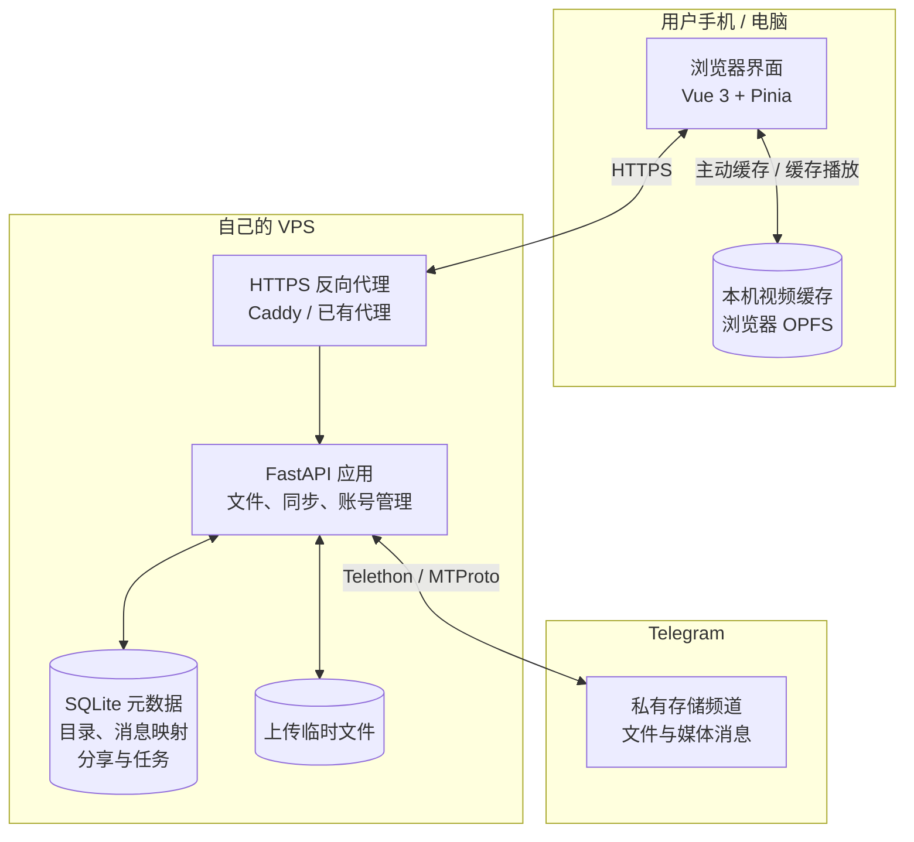
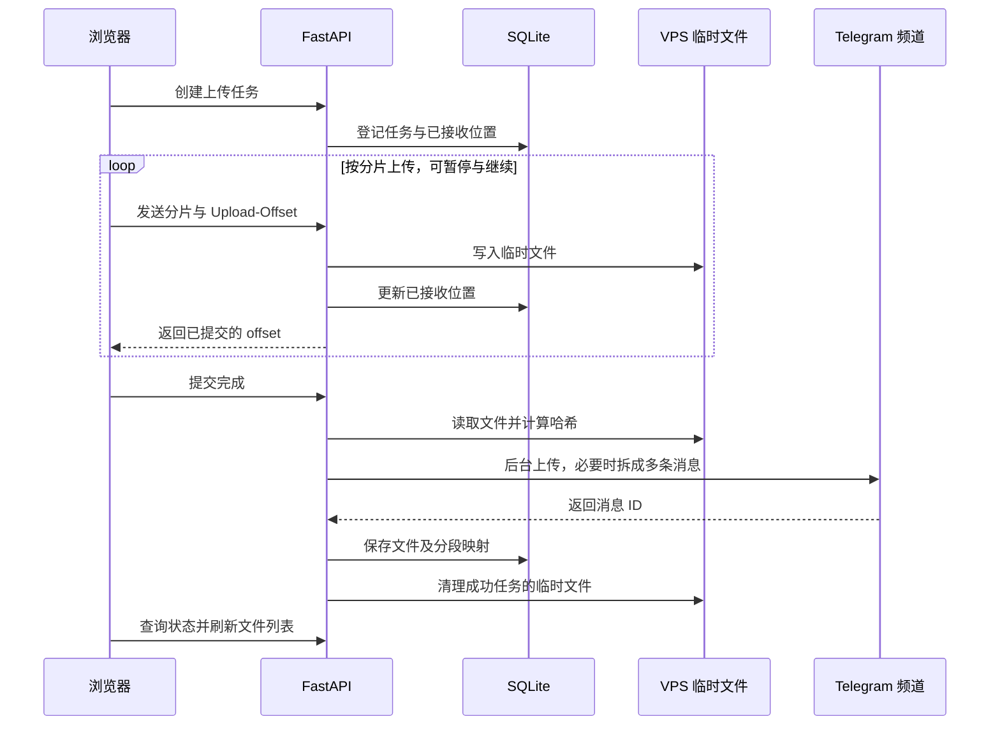
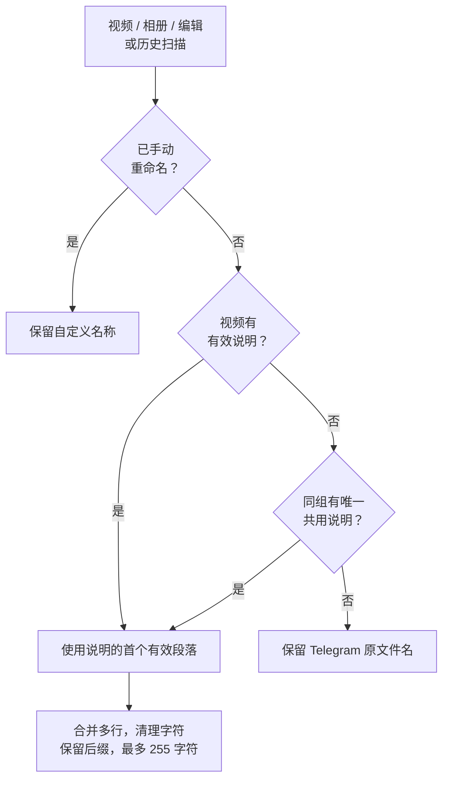
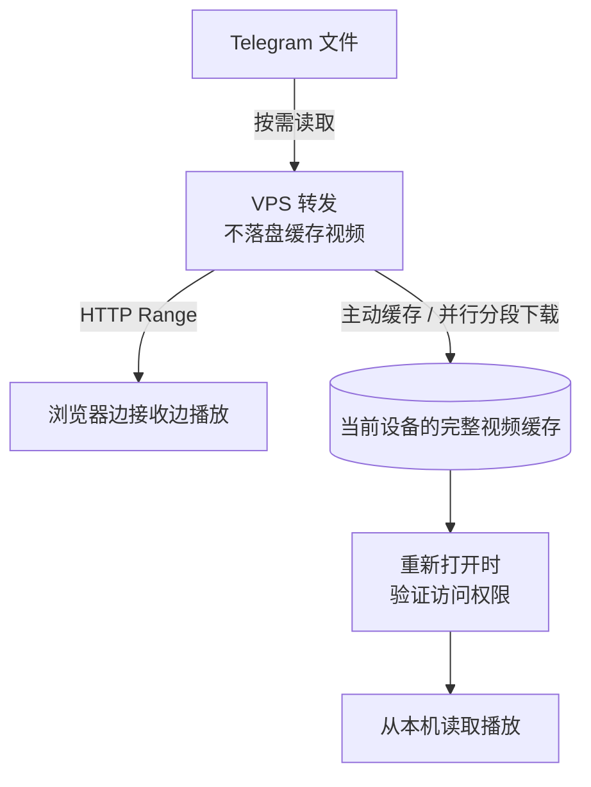

# TG Drive

**把 Telegram 私有频道变成可以整理、同步和播放的个人网盘。**

[CI 工作流](.github/workflows/ci.yml)

在浏览器上传文件，也可以直接往 Telegram 频道发送媒体。TG Drive 会自动收录、分类，并提供文件夹、搜索、分享和视频在线播放。

文件内容保存在 Telegram；VPS 保存元数据、登录会话和上传临时文件，并转发下载流量。主动开启的视频缓存写入当前手机或电脑，不写入 VPS 磁盘。

> 面向单用户、个人私有部署。支持切换 Telegram 账号和频道，但不提供多用户权限管理。重要文件请保留独立备份。

[功能概览](#功能概览) · [系统架构](#系统架构) · [快速开始](#快速开始) · [使用指南](#使用指南) · [配置参考](#配置参考) · [开发与测试](#开发与测试) · [更多文档](#更多文档)

## 功能概览

| 能力 | 说明 |
| --- | --- |
| 文件管理 | 文件夹、重命名、移动、删除、搜索、排序、分页，支持列表和网格视图 |
| 自动分类 | 图片、视频、音频、文档、压缩包、代码、安装包及其他；分类视图覆盖所有目录 |
| 分片上传 | 暂停与继续、断点续传、失败重试、队列去重；大文件按配置拆分为 Telegram 消息 |
| 频道同步 | 导入频道历史，监听新消息、编辑、删除和相册事件，并定时补同步 |
| 视频命名 | 优先使用视频简介；视频没有文字时读取同组相册的共用说明，保留手动名称 |
| 人物视频 | 按视频说明中的人名归档，支持搜索中文名和原名，并查看每个人物的视频 |
| 媒体播放 | 视频、音频、图片和 PDF 预览；支持倍速、跳转、全屏及浏览器支持的画中画 |
| 视频封面 | 优先读取 Telegram 静态缩略图，缺失时尝试在浏览器提取首帧 |
| 本机缓存 | 用户主动开启，支持进度、取消、清除及已完成缓存复用 |
| 文件分享 | 生成无需登录的文件下载链接，可设置有效期 |
| 图床 | 批量、拖拽和粘贴上传，发布图片直链，复制 Markdown / HTML 引用，搜索与撤销外链；[使用说明](docs/image-host.md) |
| 账号与频道 | 网页扫码添加个人账号、两步验证、切换频道；各频道保留独立文件空间 |
| 流量与运维 | 每日流量、额度提醒、健康检查、结构化日志、请求 ID 和 CI 检查 |

## 系统架构



### 数据分别存在哪里？

| 位置 | 保存的内容 | 需要注意 |
| --- | --- | --- |
| Telegram 私有频道 | 原始文件、照片、视频及网页上传的大文件分段 | 频道内容与网盘文件相互关联，删除网盘文件会尝试删除对应消息 |
| VPS 的 `DATA_DIR` | SQLite 数据库、账号会话、频道连接配置 | 必须备份；会话文件等同于登录凭证 |
| VPS 的 `TEMP_DIR` | 浏览器上传的临时文件 | 需要可用磁盘空间；成功写入 Telegram 后清理，未完成任务按过期配置清理 |
| 当前浏览器 | 播放进度、续传映射、用户主动开启的视频缓存 | 不会自动同步到其他设备；浏览器清理网站数据后可能丢失 |

下载与首次缓存的路径是 **Telegram → VPS → 用户设备**，视频不会绕过 VPS 直连 Telegram。按入站与出站合计，转发 1 GB 内容约产生 2 GB VPS 流量，另有协议及重传开销。

## 快速开始

### 1. 准备环境与安装依赖

- Python **3.12**。
- Node.js **22.15+** 和 npm，用于前端构建及测试；CI 使用 Node 22。
- 一个 Telegram 账号、可访问的私有频道，以及自己申请的 [Telegram API 凭据](https://my.telegram.org)。
- VPS 部署请使用 Docker Compose v2，并参考 [部署指南](DEPLOY.md)。

将 `OWNER` 替换为仓库所在的用户或组织。

```bash
git clone https://github.com/OWNER/tgdrive.git
cd tgdrive
```

<details open>
<summary>Linux / macOS</summary>

```bash
python3 -m venv .venv
source .venv/bin/activate
python -m pip install -r requirements-dev.txt
cp .env.example .env
```

</details>

<details>
<summary>Windows PowerShell</summary>

```powershell
python -m venv .venv
.\.venv\Scripts\Activate.ps1
python -m pip install -r requirements-dev.txt
Copy-Item .env.example .env
```

</details>

修改 `.env` 中的以下配置。这里的值仅为占位示例，密码与密钥请自行生成：

```dotenv
APP_PASSWORD=your-own-long-password
APP_SECRET=replace-with-your-own-random-secret-at-least-32-characters
TG_MODE=user
TG_API_ID=123456
TG_API_HASH=your-api-hash
TG_CHAT_ID=-1001234567890
```

**检查代理配置。** 如需指定代理，在本机 `.env` 填写 `TG_PROXY`。留空时程序会尝试读取系统或环境代理。服务器需要能够访问 Telegram。

### 2. 登录 Telegram 并选择存储频道

```bash
python scripts/login_qr.py
python scripts/chat_id.py
```

按脚本提示，在 Telegram 的“设置 → 设备 → 连接桌面设备”扫描二维码。`chat_id.py` 会列出频道信息，将目标频道 ID 写入 `.env` 的 `TG_CHAT_ID`。账号应有该频道发送和删除消息的权限。

脚本会生成本地会话文件。不要在服务运行时，用同一份会话同时启动另一套应用或登录脚本。启用两步验证时按登录脚本提示操作；网页内添加账号则可直接在界面输入密码。

### 3. 构建并启动

```bash
cd frontend
npm ci
npm run build
cd ..
python -m uvicorn app.main:app --host 127.0.0.1 --port 8787
```

打开 [本地网盘](http://127.0.0.1:8787)，输入 `APP_PASSWORD` 登录。启动后会自动扫描存储频道；也可以点击“频道同步 → 重新扫描历史”。

[存活检查](http://127.0.0.1:8787/api/health/live) 验证进程状态，[就绪检查](http://127.0.0.1:8787/api/health/ready) 同时验证数据库与 Telegram 连接；就绪检查返回 503 时，可据响应内容排查连接配置。

生产部署由 Docker 多阶段构建前端，无需在 VPS 宿主机安装 Node.js。域名、HTTPS、数据卷、备份与升级步骤见 [DEPLOY.md](DEPLOY.md)。使用已有反向代理的服务器，应按实际编排接入，避免重复占用 80/443 端口。

## 使用指南

### 上传文件与断点续传

拖入文件或使用上传按钮，文件会保存到当前目录；从分类页面上传时保存到根目录，并按实际类型归类。



- 暂停只影响浏览器传输；已经开始写入 Telegram 的后台任务会继续，不能暂停或取消。
- 刷新页面后需要重新选择原文件，系统会查询服务端 offset 后续传；浏览器不会保留本地文件读取权限。
- 服务端重启后，中断的 Telegram 上传会标记为可重试，不支持从已上传的 Telegram 分段中间接续。
- 未完成任务默认保留 72 小时；运行期间每 5 分钟清理，暂停任务也受保留时间限制。

### 频道同步与视频名称

直接把照片、视频、音频或文档发送到存储频道，就会收录到网盘根目录。相册中的每条媒体分别收录；纯文字、链接预览和网盘自己生成的 `tgdrive:v1:` 文件分段不会重复导入。



相册按 Telegram 的 `grouped_id` 关联。例如，一组“封面图片 + 视频”的概述写在图片消息上，视频也能使用这段概述命名；不会借用相邻独立消息的文字。独立链接和标签行会跳过，多个不同的相册说明不会被强行合并。

启动时完整扫描，平时默认每 30 秒补同步新增消息；网页每 5 秒检查同步变化。断线期间的编辑和删除，可通过“重新扫描历史”补齐。手动重命名后的文件保留自定义名称；替换整条消息里的媒体仍会更新对应文件信息。

### 按人物查找频道视频

打开网站顶部的「人物视频」进入人名目录。每个人名旁会显示收录的视频数，点开即可浏览和播放该人物的频道视频。同一部视频可以归到多个人名下。

在「人物视频」可新增或删除标签。进入「全部视频」，在视频的更多操作中选择「分配人物标签」，勾选后保存。删除标签会解除所有关联并保留视频，手动调整在频道重新同步后仍然有效。视频列表每页显示最多 10 部。

打开视频后，可在「播放设置 → 定时关闭」选择 15、30、60 分钟或输入自定义分钟。到点自动关闭预览，倒计时期间可以重设或取消。

英文名和日文名优先显示中文写法，旁边保留原名。两种写法都可以搜索。英文名优先使用常用译名，其余按 Carnegie Mellon Pronouncing Dictionary 的发音近似音译。日文汉字转为简体写法，假名按读音转写。无法确认发音的英文名会保留原名。

可在服务端 `.env` 设置 `PEOPLE_AI_BASE_URL`、`PEOPLE_AI_MODEL` 和 `PEOPLE_AI_API_KEY`，为新发或编辑的视频增加模型识别。应用先在本地收录，再把去掉链接和 Telegram 用户名的视频描述文本发给模型，补充人物、中文译名和描述中已有的别名。模型不可用时保留本地结果，同一描述会复用已成功的分析。启动时扫描历史视频不会批量请求模型。

系统在本地识别视频描述中的中文人名。自动识别可能漏掉昵称或不常见的名字。需要指定人名时，可在描述中另起一行写 `人物：张三、李四、Jane Doe`，系统会优先采用明确列出的人名。修改视频描述后，同步会更新人物归档。

升级后，已登录的 Telegram 用户会话会在启动扫描时为历史视频建立索引，也可从「频道同步 → 重新扫描历史」触发。备用 Bot 需要加入存储频道，并在服务端设置 `TG_BOT_FALLBACK_TOKEN`。备用 Bot 可以给它收录的新视频和后续描述修改归档，历史回填需要 Telegram 用户会话。

### 视频播放、封面与本机缓存

点击视频或音频打开播放器，支持 0.5–2 倍速、前后跳转 10 秒、音量、全屏及可用时的画中画。Chrome、Edge 和 iPhone 的兼容播放按浏览器能力选择接口；不进行服务端转码，实际支持的编码仍由设备决定。



| 项目 | 当前行为 |
| --- | --- |
| 普通媒体 | 使用原生播放器；在当前浏览器保存最多 100 个文件的播放位置 |
| H.264/AAC 分片 MP4 | 使用 MediaSource 或 iPhone 的 ManagedMediaSource，跳转到未缓冲位置后从目标附近的关键帧开始缓冲 |
| 预缓冲 | 默认按实际吞吐和码率自动调整，可选最多 60 秒或 120 秒，iPhone 还遵守系统缓冲窗口 |
| 视频封面 | 优先使用 Telegram 缩略图；缺失时尝试浏览器首帧，提取最多并发两个任务 |
| 缓存到本机 | 浏览器支持 OPFS 与 Web Locks 时可用，按带宽调整分段并发，优先保留近期使用的完整视频与分片 MP4 文件头 |
| 缓存限制 | 首次仍经 VPS 转发；关闭播放器会取消未完成缓存，空间不足或清除网站数据会影响可用性 |

关闭播放器会停止播放并释放连接。键盘支持空格播放/暂停、方向键跳转、M 静音、F 全屏。详细行为见 [视频播放与本机缓存指南](docs/video-playback.md)。

### 账号、频道与文件分享

- 点击“Telegram 账号”（手机上为“账号”）扫码添加个人账号，完成两步验证后选择频道；最多保存 10 个账号/频道组合。
- 扫码后在手机上确认。若网页仍显示二维码，可点击“已扫码，检查验证状态”。需要两步验证时，网页会显示 Telegram 密码输入框，验证通过后可选择频道。
- 每个频道保留独立的目录、分享、上传任务和同步记录，切回即可恢复。两步验证密码不会通过网页登录流程落盘。
- 正在写入 Telegram 的上传完成前不能切换；未完成的浏览器上传留在原频道，切回后可续传。
- 分享链接无需登录，可设有效期；对应频道未处于当前连接时，该频道的分享不可用。分享链接暂不支持密码保护。

Bot 模式也可用于网页上传：设置 `TG_MODE=bot`、`TG_BOT_TOKEN`，同时保留 `TG_API_ID`、`TG_API_HASH` 和 `TG_CHAT_ID`，并将 Bot 设为频道管理员。Bot 模式受 Telegram 历史读取限制，不能保证完整频道历史导入。

### VPS 每日流量

顶部流量按钮显示今日用量、剩余额度和近 7 天记录。默认额度为 **100 GB/天**，按北京时间 00:00 重置，可在页面调整；达到 80% 和 100% 时提醒，不会自动中断传输。

宿主机采集统计公网网卡的入站与出站，包含其他应用和网络重传；项目传输明细单独展示。需要按 [部署指南](DEPLOY.md) 安装采集服务，未安装时显示“流量待接入”。

## 配置参考

完整配置见 [.env.example](.env.example)，以下列出常用项：

| 配置 | 默认值 / 示例 | 用途 |
| --- | --- | --- |
| `APP_PASSWORD` | 必须自行设置 | 网盘访问密码 |
| `APP_SECRET` | 必须自行设置 | 会话签名密钥；生产环境至少 32 字符 |
| `TG_MODE` | `user` | 用户账号或 `bot` 模式 |
| `TG_API_ID` / `TG_API_HASH` | 自行申请 | Telegram API 凭据，两种模式都需要 |
| `TG_CHAT_ID` | `-100…` | 当前默认存储频道 |
| `TG_SESSION` | `data/tgdrive` | 默认会话路径，Telethon 自动添加 `.session` 后缀 |
| `TG_PROXY` | 按网络设置 | 显式指定 Telegram 代理，优先于系统 / 环境代理 |
| `TG_SEGMENT_SIZE` | `1800000000` | 网页上传时单条 Telegram 消息的分段大小，单位字节 |
| `UPLOAD_CHUNK_SIZE` | `8388608` | 浏览器上传分片大小，默认 8 MiB |
| `UPLOAD_CONCURRENCY` | `2` | 同时写入 Telegram 的后台任务数 |
| `UPLOAD_STALE_HOURS` | `72` | 未完成上传保留时长；`0` 关闭自动过期清理 |
| `MAX_FILE_SIZE` | `0` | 文件大小上限，单位字节；`0` 表示不设应用层上限 |
| `CHANNEL_SYNC_ENABLED` | `true` | 是否启用频道同步 |
| `CHANNEL_SYNC_INTERVAL` | `30` | 新增消息补同步间隔，单位秒，最小 5 秒 |
| `COOKIE_SECURE` | 本地 `false`，Compose `true` | 生产环境使用 HTTPS；本地 HTTP 不应开启 |
| `DOMAIN` / `ACME_EMAIL` | 生产部署时设置 | 默认 Caddy 编排使用的域名和证书邮箱 |

**部署约束：** 只运行一个应用进程 / Uvicorn worker。上传互斥锁、调度和账号切换在进程内协调，不能让多个进程共用同一临时目录或会话。

## 开发与测试

技术栈：**Vue 3 · TypeScript · Pinia · Vite · FastAPI · Telethon · SQLite WAL**。

开发时分别启动后端和前端：

```bash
# 终端一：项目根目录，已激活 Python 虚拟环境
python -m uvicorn app.main:app --host 127.0.0.1 --port 8787 --reload

# 终端二
cd frontend
npm run dev
```

打开 [前端开发页面](http://127.0.0.1:5173)。Vite 将 `/api` 和 `/s/` 请求代理到后端；开发环境可通过 [OpenAPI 页面](http://127.0.0.1:8787/api/docs) 查看接口。

```bash
# 项目根目录
python -m ruff check app tests
python -m ruff format --check app tests
python -m pytest --cov=app --cov-report=term-missing

# 前端目录
cd frontend
npm test
npm run typecheck
npm run build
```

也可在支持 Make 的环境执行 `make check`。GitHub Actions 检查后端 lint / 格式 / 测试、前端测试与构建、宿主机采集脚本兼容性，以及 Docker 镜像构建。

### 目录结构

```text
app/
├── api/routes/          # 认证、文件、上传、同步、账号及流量接口
├── services/            # 上传任务、频道同步、账号切换、流量统计
├── core/                # 日志、请求上下文、限流与异常处理
├── categories.py        # 文件分类与 MIME 规则
├── config.py            # 环境配置与校验
├── db.py                # SQLite 查询与 schema 迁移
├── storage.py           # Telegram 上传、下载及频道消息访问
└── main.py              # FastAPI 应用入口
frontend/
├── src/components/      # 文件界面、播放器及配置面板
├── src/stores/          # Pinia 状态与任务队列
├── src/utils/           # 分片播放、本机缓存、封面提取等
└── tests/               # 前端回归测试与浏览器缓存检查
tests/                   # 后端单元与集成测试
scripts/                 # Telegram 登录、频道 ID、宿主机流量采集
deploy/                  # VPS、Caddy 与 systemd 部署辅助
docs/                    # 架构、播放指南与历史验证记录
static/dist/             # 前端构建产物，不提交到 Git
```

## 备份与已知限制

- 备份 `.env` 与完整 `DATA_DIR`，包括主数据库、`accounts/` 会话和 `channels/` 数据库；使用命名卷部署时以实际卷路径为准。备份方法见 [DEPLOY.md](DEPLOY.md)。
- 当前元数据 schema 为 **v14**。升级前备份完整数据卷。回退到只支持旧 schema 的镜像时，必须一并恢复匹配的数据备份。
- 会话文件和 `.env` 包含敏感凭据，不应提交 Git、公开分享或传给他人。网页扫码添加账号不会把两步验证密码写入磁盘。
- 支持大文件分段，不等于无限容量或无限带宽；仍受 Telegram 接口、账号限制及 VPS 资源影响。
- 不提供服务端转码、秒传、多用户权限管理或 Telegram 分段级上传续传。浏览器不支持的编码需要下载后使用本地播放器。
- Telegram 云端聊天不是端到端加密存储；敏感文件请自行加密。不要将该项目当作公共 CDN，重要文件请另存独立副本。

## 更多文档

| 文档 | 内容 |
| --- | --- |
| [VPS 部署与运维](DEPLOY.md) | HTTPS、数据卷、流量采集、备份、升级与故障排查 |
| [架构说明](docs/ARCHITECTURE.md) | 后端与前端分层、状态机、频道空间和请求生命周期 |
| [视频播放与本机缓存](docs/video-playback.md) | iPhone 兼容播放、缓存边界、封面和简介命名 |
| [更新记录](CHANGELOG.md) | 已完成的功能与修复 |
| [历史验证记录](docs/CHANNEL_SYNC_AND_PLAYER_TEST.md) | 频道同步与播放器的阶段性验证 |
| [分类验证记录](docs/FRONTEND_CLASSIFICATION_TEST.md) | 文件分类、分页与前端交互 |

历史验证记录反映当时版本，当前行为以代码和现行指南为准。
